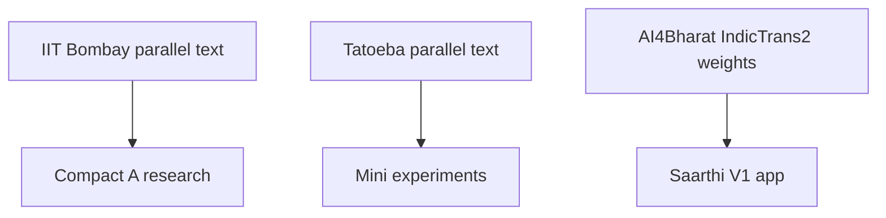
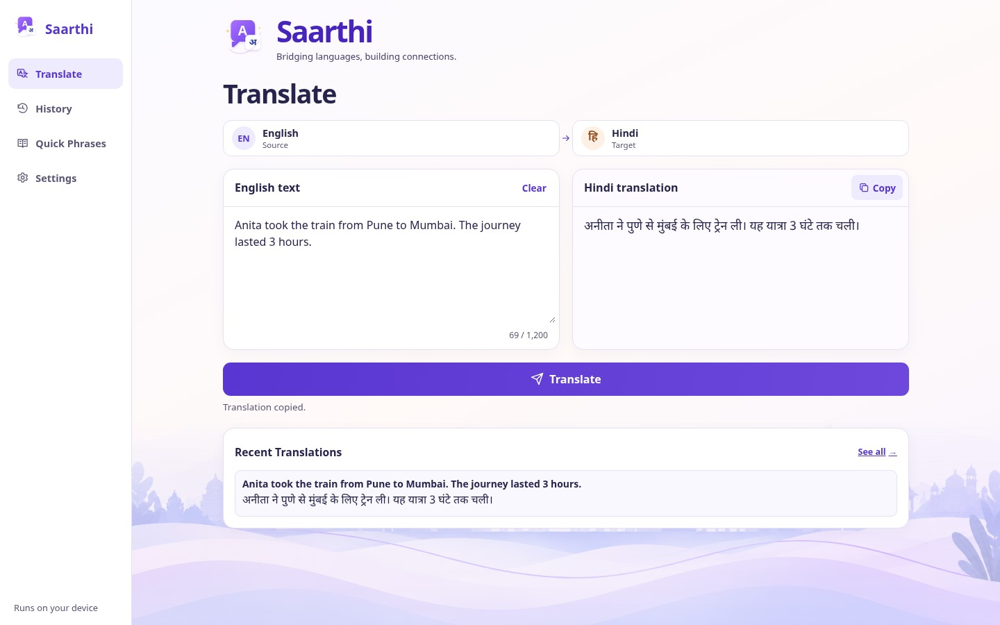

# Saarthi · English → Hindi Neural Machine Translation

Saarthi explores how to turn English text into useful Hindi and how to tell when a translation preserves the original meaning. One project connects three kinds of work: implementing a Transformer, evaluating a smaller model under compute constraints, and shipping a local translation application.

**For the OJT live demo, use Saarthi V1.** The app sends English text to a local Python server running AI4Bharat’s pretrained IndicTrans2 on CPU. Compact A and Mini are scratch-trained research models with separate checkpoints and evaluations.

| Component | Original contribution | Status and location |
|---|---|---|
| **A · Saarthi Compact A** | Custom PyTorch Transformer, preprocessing, SentencePiece tokenization, training, checkpointing, and evaluation | Research implementation on `main` in `src/`. Repaired-corpus pilot received a NO-GO for translation use. [Compact A guide](docs/ojt/compact-a.md) |
| **B · Saarthi Mini** | Smaller custom architecture, CPU training pilots, controlled learning-rate comparison, decoding diagnostics, and bilingual coverage audit | Experimental. Verified source and reports are on local Mini branches. [Mini guide](docs/ojt/mini.md) |
| **C · Saarthi V1** | Purple desktop/mobile UI, local inference integration, translation history, Quick Phrases, and end-to-end browser verification | Working demo on `feature/saarthi-v1-app`, currently [draft PR #5](https://github.com/keerthikajain/Neural-Machine-Translation-System/pull/5). [V1 setup and demo](docs/ojt/v1-app.md) |

### Working application

The screenshots show the runnable revision in draft PR #5. The [app guide](docs/ojt/v1-app.md) explains the separately verified local React revision and which setup commands apply to each.

[Mobile screenshot](https://raw.githubusercontent.com/keerthikajain/Neural-Machine-Translation-System/f706501da5be18e126c636d5bfe92b34e669cef5/docs/screenshots/mobile.jpg) · [Installation and demo procedure](docs/ojt/v1-app.md)

### What we measured

| Model and evaluation | BLEU | chrF++ | Source-faithfulness evidence |
|---|---:|---:|---|
| Compact A repaired-corpus 3K pilot checkpoint, 520 IIT Bombay validation rows | 0.267 | 11.826 | 0/42 automated synthetic contrasts |
| Mini Pilot 3 treatment, 203 distinct Tatoeba development sources | 1.84 | 16.14 | 0/203 exact matches. Number tokens preserved in 3/11 cases. Correct quantity with its referent in 0/11. |
| IndicTrans2 INT8, 520 IIT Bombay validation rows | 23.210 | 49.674 | 34/42 automated synthetic contrasts. One manual review found a decimal error. |

BLEU and chrF++ compare generated text with reference translations. Mini used a different corpus and setup, so its scores cannot establish a ranking against the other runs. Possible overlap between IndicTrans2 pretraining and the IIT Bombay validation set remains unmeasured. See the component guides for decoding settings, comparison limits, and the research decisions.

### Stack, credits, and next work

- **Compact A** uses PyTorch, a custom encoder–decoder, and SentencePiece. The parallel corpus is credited to IIT Bombay CFILT. [IIT Bombay corpus and citation](https://www.cfilt.iitb.ac.in/iitb_parallel/)
- **Mini** reuses the custom Transformer layers with smaller dimensions and a train-only SentencePiece tokenizer. Its pinned English–Hindi export credits Tatoeba contributors under CC BY 2.0 France. [Tatoeba data and attribution](https://tatoeba.org/en/downloads)
- **V1** uses a local Python HTTP server, CTranslate2 INT8 CPU inference, and the original Saarthi browser interface. The published draft uses HTML, CSS, and JavaScript. The later local revision uses React with the same Python API. [AI4Bharat model](https://huggingface.co/ai4bharat/indictrans2-en-indic-dist-200M) · [Pinned CPU conversion](https://huggingface.co/zaidwhys/indictrans2-en-indic-dist-200M-ct2-int8/tree/abf8512c45febe9cc9fbb30ee781bb3be4f18956)

Finish the Windows launcher smoke test before V1 release sign-off. For Mini, complete the independent bilingual review and dataset curation gates before any training decision. Use bilingual source-faithfulness checks to guide future Compact A research. Private corpora, checkpoints, and sealed evaluation artifacts stay outside Git.

[OJT presentation](docs/ojt/presentation.md) · [Viva notes](docs/ojt/viva.md) · [Verification report](docs/ojt/verification.md) · [Historical project write-up](https://github.com/keerthikajain/Neural-Machine-Translation-System/blob/febc34af7ab5ef63322f57df40a61fb73818185c/README.md)
