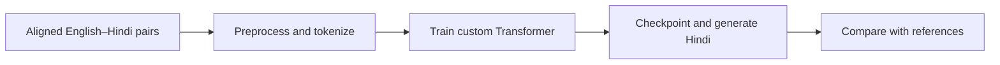

# A · Saarthi Compact A

Compact A is the original scratch-trained NMT research component. It uses **31,980,800 trainable parameters** at vocabulary size 32,000, four encoder and four decoder layers, width 256, four attention heads, a width-1024 feed-forward layer, and a 128-position configuration. The older research README also describes the larger, separate reference configuration.



The encoder builds representations of English tokens. The decoder uses masked self-attention over its Hindi prefix and cross-attention to the source. The training loader shifts target tokens to predict the next piece. The evaluator generates autoregressively, so BLEU, chrF++, and contrast scores answer different questions from teacher-forced loss.

| Purpose | Existing path |
|---|---|
| Corpus preparation and splits | [preprocess.py](../../src/data/preprocess.py), [dataset.py](../../src/data/dataset.py) |
| SentencePiece | [train_sentencepiece.py](../../notebooks/train_sentencepiece.py) |
| Compact A configuration | [transformer.py](../../src/model/transformer.py) |
| Training, checkpointing, and scoring | [train_nmt.py](../../src/training/train_nmt.py), [trainer.py](../../src/training/trainer.py), [evaluator.py](../../src/evaluation/evaluator.py) |
| Historical implementation notes | [Learning log](../PROJECT_LEARNING_LOG.md), [pipeline verification](../TRAINING_PIPELINE_VERIFICATION.md) |

The IIT Bombay corpus was prepared and later audited and partially repaired. The screened repaired corpus had 1,397,810 aligned pairs after eight sensitive pairs were quarantined. It stays outside Git. The earlier 50K checkpoint is historical and carries a privacy limitation, so preserve it privately. For the screened-corpus pilot, the 20K weights were the warm start, fresh optimizer state was used, and evaluation stopped at the planned 5,000 additional updates.

| Compact A checkpoint | Validation BLEU | Validation chrF++ | Automated contrasts |
|---|---:|---:|---:|
| Untouched 20K | 0.345 | 10.956 | 0/42 |
| Best screened pilot, +3K | 0.267 | 11.826 | 0/42 |
| Last screened pilot, +5K | 0.288 | 11.406 | 0/42 |

These comparisons used 520 validation lines and a greedy 64-token cap, as described in the [evaluation documentation on the V1 branch](https://github.com/keerthikajain/Neural-Machine-Translation-System/blob/f706501da5be18e126c636d5bfe92b34e669cef5/docs/evaluation.md). The best pilot improved chrF++ by 0.870 and lower loss showed some learning under teacher forcing. The repeated contrast failures, omissions, and invented content supported the NO-GO decision for use as a translator.

## Reproduce the code checks

From the repository root in a Python environment with [research dependencies](../../requirements.txt) installed, run the CPU checks below. The historical runs require the correct corpus, tokenizer, runtime, and checkpoint manifests in addition to the repository.

```bash
python -m src.training.train_nmt --help
python -m unittest discover -s tests -p 'test_phase3_compact_a.py' -v
```

The training CLI's explicit Compact A selector is `--architecture compact_a`. The separate `train_model.py` launcher uses reference-model defaults. PR [#3](https://github.com/keerthikajain/Neural-Machine-Translation-System/pull/3) holds separate training optimizer work and remains a draft.
