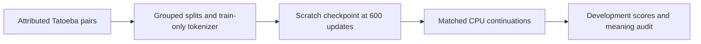

# B · Saarthi Mini

Mini tests whether a **1,410,112-parameter** custom encoder–decoder can learn useful English → Hindi translation with a small parallel corpus and limited CPU time. It reuses the project’s Transformer layers with two encoder and two decoder layers, width 128, four attention heads, and width-384 feed-forward layers. Its 1,600-piece joint unigram SentencePiece tokenizer was fitted on training text only. The pilot used 2,397 training pairs and assessed generation on 203 distinct development sources with reference alternatives. It credits the individual contributors in the pinned Tatoeba export `mini-tatoeba-20260213-v1`. [Tatoeba data and licensing](https://tatoeba.org/en/downloads)



| Study | Verified result |
|---|---|
| Pilot 1 | Scratch run selected update 600. Validation BLEU 0.63 and chrF++ 11.27. Repetition and loss of source meaning remained pronounced. |
| Pilot 2 | Continued from update 600 at 0.0001. Selected update 1,200 at chrF++ 13.11 under the preset selection rule. Last checkpoint at 1,650 reached 13.45. |
| Fixed-weight decoding | On the selected Pilot 2 weights, greedy scored chrF++ 13.11 and width-three beam with length reranking reached 14.64. Both had 0/11 numbers under the lexical check and 0/203 exact matches. |
| Pilot 3 | Matched both arms at update 1,650, starting from the same verified update-600 weights, optimizer buffers, and random state. The continuation learning rate was the only changed configuration. |
| Pilot 4 preparation | Audited semantics and corpus coverage. Froze review and curation procedures and prepared 120 candidate pairs. Independent review, approval, and construction of the treatment corpus are pending. |

### Pilot 3 results at update 1,650

| Development metric | Control 0.0001 | Treatment 0.0003 |
|---|---:|---:|
| BLEU | 0.85 | 1.84 |
| chrF++ | 13.45 | 16.14 |
| Exact matches | 0/203 | 0/203 |
| Numeric lexical preservation | 0/11 | 3/11 |
| Named-entity lexical preservation | 17/22 | 18/22 |
| Repeated word trigrams | 34/203 | 11/203 |

The 2.69-point chrF++ gain missed the predeclared +3.0 threshold. The later semantic audit found 0/11 reliable quantity–referent cases in the treatment outputs. Some translations retained a number while losing the counted noun or event. The audit found 48 training rows matching forms of “see” and two containing “mouse,” with no matching combination. A seen action–object combination still failed in a different context. Sparse coverage and weak transfer are plausible contributors. The audit does not establish a single cause or a population-wide accuracy estimate.

**Decision:** NO-GO for further training and V1 integration until independent bilingual review and data-curation gates are satisfied. Pilot 4 has no model results. The independent test remains sealed.

### Locate and reproduce the research

These branches and commit IDs were verified in the local research clone. They were unavailable on GitHub when this guide was prepared. The docs branch publishes aggregate evidence only.

| Local branch | Verified revision | What it contains |
|---|---|---|
| `saarthi-mini-pilot2` | `82c0c85` | Continuation and fixed-weight decoding diagnostics |
| `saarthi-mini-pilot3` | `c4553ac` | Matched continuation protocol, tests, and report |
| `saarthi-mini-pilot4-audit` | `8e3cbcc` | Bilingual coverage and semantic audit |
| `saarthi-mini-pilot4-curation` | `b137682` | Review procedures and controlled dataset-curation tooling |

In the existing local Mini checkout at the curation revision, use Python 3.12, CPU PyTorch 2.8, SentencePiece 0.2.3, and SacreBLEU 2.6.0. To inspect the entry points and rerun source-only tests:

```bash
python -m saarthi_mini.train --help
python -m saarthi_mini.pilot3 --help
python -m saarthi_mini.decode_diagnostics --help
python -m unittest discover -s tests -p 'test_mini*.py' -v
```

For an evaluation replay, use the archived protocol and matching local corpus manifest, tokenizer, and checkpoint. A public clone has the study summary and cannot replay these private experiment artifacts. The held-out examples, review packets, raw corpora, and weights are excluded from this PR.
