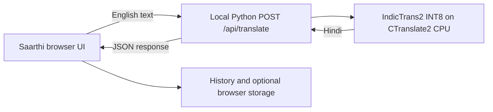

# C · Saarthi V1 application

V1 is the working OJT demo. The original purple UI, logo and skyline, desktop sidebar, mobile bottom navigation, Quick Phrases, searchable history, settings, clipboard, and error recovery connect to one local English → Hindi inference API.



The project implements the interface, request validation, pinned-model setup, CPU integration, history behavior, and evaluation. **AI4Bharat trained the pretrained IndicTrans2 model.** V1 uses the pinned zaidwhys INT8 conversion of the 200M distilled model. Its download is about 224 MB. The app checks the weights’ SHA-256 and uses `eng_Latn → hin_Deva` with beam width four. It accepts up to 1,200 characters and reports passages that exceed the model token limit. No API account is required. The custom research checkpoints are independent of this inference path. [AI4Bharat model card](https://huggingface.co/ai4bharat/indictrans2-en-indic-dist-200M) · [Pinned conversion](https://huggingface.co/zaidwhys/indictrans2-en-indic-dist-200M-ct2-int8/tree/abf8512c45febe9cc9fbb30ee781bb3be4f18956)

## Run the published draft

GitHub has [draft PR #5](https://github.com/keerthikajain/Neural-Machine-Translation-System/pull/5) at `f706501` on `feature/saarthi-v1-app`. It is open and unmerged. Use a separate clone if you have uncommitted work. The published draft uses plain HTML, CSS, and JavaScript.

```text
git clone --branch feature/saarthi-v1-app https://github.com/keerthikajain/Neural-Machine-Translation-System.git saarthi-v1
cd saarthi-v1
python -m venv .venv
```

In Windows PowerShell with Python 3.11 or 3.12:

```powershell
.\.venv\Scripts\python.exe -m pip install -r requirements-app.txt
.\.venv\Scripts\python.exe -m saarthi_app.setup_model
.\.venv\Scripts\python.exe -m saarthi_app
```

On Linux or macOS with Python 3.11 or 3.12:

```bash
.venv/bin/python -m pip install -r requirements-app.txt
.venv/bin/python -m saarthi_app.setup_model
.venv/bin/python -m saarthi_app
```

Open [localhost:8000](http://127.0.0.1:8000/). Translate **Anita took the train from Pune to Mumbai. The journey lasted 3 hours.** The verified result was **अनीता ने पुणे से मुंबई के लिए ट्रेन ली। यह यात्रा 3 घंटे तक चली।** Show Copy, Recent Translations, and Quick Phrases. Explain that saving history across browser sessions is optional and stays in that browser. The first translation can take longer while the model loads.

The Linux launcher passed. Windows release sign-off still requires running [run_demo.ps1](https://github.com/keerthikajain/Neural-Machine-Translation-System/blob/f706501da5be18e126c636d5bfe92b34e669cef5/run_demo.ps1) and translating a sample on Windows. Python module startup above is the alternative for the presentation rehearsal.

## Local React revision

A newer local checkout preserves the purple design and faded artwork, uses one Quick Phrases page, and renders the UI in React. Its tests and browser smoke checks passed. From that existing checkout, run `npm ci` and `npm run build` with Node.js 20 or newer before starting the same Python module. Those build commands apply to the local React revision. This documentation PR does not publish that application code.

[Published desktop screenshot](https://raw.githubusercontent.com/keerthikajain/Neural-Machine-Translation-System/f706501da5be18e126c636d5bfe92b34e669cef5/docs/screenshots/desktop.jpg) · [Published mobile screenshot](https://raw.githubusercontent.com/keerthikajain/Neural-Machine-Translation-System/f706501da5be18e126c636d5bfe92b34e669cef5/docs/screenshots/mobile.jpg)

## Evaluation limits

With the shared greedy 64-token comparison setup, the INT8 conversion scored **23.210 BLEU**, **49.674 chrF++**, and **34/42** automated source contrasts. The separate interactive check preserved the reviewed facts on **18/20** synthetic examples using the app’s beam settings. A greedy contrast changed 4.2 km to 4 km. Check consequential names, numbers, and instructions. Pretraining overlap with the IIT Bombay validation set was not assessed. The OJT demo shows the implemented English → Hindi path. Voice input, language swapping, and the standalone welcome screen are outside this draft.

[Evaluation protocol and reproduction](https://github.com/keerthikajain/Neural-Machine-Translation-System/blob/f706501da5be18e126c636d5bfe92b34e669cef5/docs/evaluation.md) · [Application code and dependencies](https://github.com/keerthikajain/Neural-Machine-Translation-System/tree/f706501da5be18e126c636d5bfe92b34e669cef5/saarthi_app)
